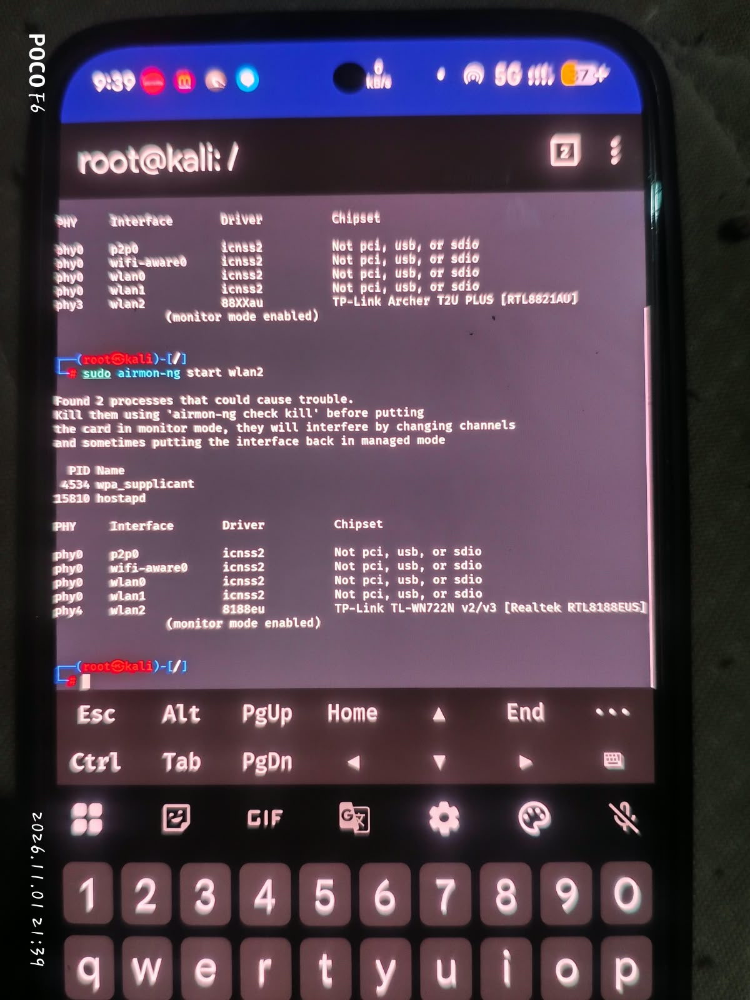
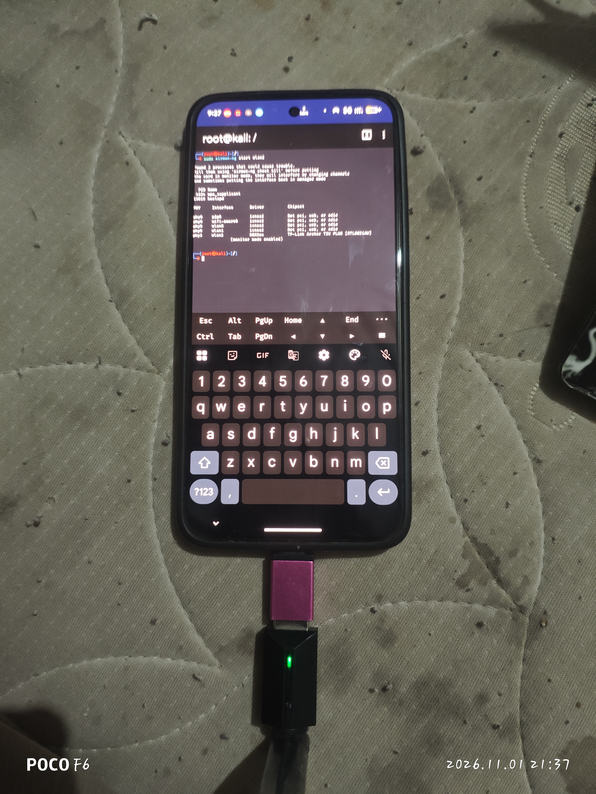

<div align="center">

# ONYX NETHUNTER

### POCO F7 · Unofficial community kernel

**KernelSU Next · External Wi-Fi · USB HID**

[](https://github.com/ROHITSHARMA838888/poco-f7-nethunter/releases/tag/v0.1.2)
[](#installation)
[](docs/testing/README.md)

[](https://t.me/POCO_F7_NETHUNTER)
[](https://t.me/poco_f7_discussion)
[](SOURCE.md)


**Built for the tested onyx ROM setup. Original upstream authorship and licences retained.**

</div>

> [!WARNING]
> **Read compatibility and backup requirements before flashing.** This release is tested only on **POCO F7 / onyx running the exact Infinity-X 4.1 Android 17 build below**. Other ROMs, newer builds and other devices are not verified. Do not bypass installer checks. Keep a working recovery method and your own pre-flash boot backup.

> [!NOTE]
> This is an **unofficial community project**, not an official Kali NetHunter release. The kernel ZIP and the KernelSU Wi-Fi module are separate packages with different installation methods.

**Quick navigation:** [Compatibility](#tested-device-and-rom) · [Features](#features-and-test-status) · [Downloads](#downloads) · [Installation](#installation) · [Rollback](#rollback-and-recovery) · [Photos](#testing-photos) · [Credits](#credits-and-source-links)

## Tested device and ROM

| Item | Verified setup |
| :--- | :--- |
| Device | **POCO F7** |
| Codename | **onyx** |
| ROM | **Infinity-X 4.1** |
| Android / SDK | **Android 17 / SDK 37** |
| ROM incremental | `1792766195` |
| Security patch | `2026-10-01` |
| Recovery used | **OrangeFox R12, unofficial** |
| Kernel version | **Linux 6.6.142** |
| Exact running kernel release | `6.6.142-4k-g7750565ada3d-dirty` |
| Wi-Fi module version | `v0.1.2-dual-wifi-fix` · versionCode `4` |

Matching only the Android version or “GKI 6.6” is **not** sufficient. The kernel must match the ROM's vendor-module ABI and the boot layout. An OTA or another Infinity-X build needs a new compatibility review.

### Kernel base

The current build uses [xiaomi-onyx-playground/android_kernel_xiaomi_sm8735](https://github.com/xiaomi-onyx-playground/android_kernel_xiaomi_sm8735/tree/7750565ada3d57e195798519b005d2b038e888c1), pinned to:

```text
7750565ada3d57e195798519b005d2b038e888c1
```

**This release is not Konoha-based.** The early Konoha 6.6.143 experiment compiled but did not match the tested ROM's module ABI. Old Actions outputs are historical build evidence, **not downloads to flash**. Use the release assets below.

## Features and test status

| Component | What is included / verified |
| :--- | :--- |
| **KernelSU Next** | Real pinned source integration; Android boot and root verified |
| **Archer T2U Plus** | `88XXau`, USB `2357:0120`; monitor transitions, monitor-UP and bounded probe injection verified |
| **TL-WN722N v2/v3** | `8188eu`, USB `2357:010c`; monitor transitions, monitor-UP, LED and bounded probe injection verified |
| **Probe injection** | Each adapter returned **29/30 directed replies** in one test against the tester's own phone hotspot |
| **Persistent Wi-Fi module** | Both fixed drivers auto-load after reboot; post-reboot adapter attachment checked |
| **USB stability guard** | Targeted ROM USB-reset workaround; hub permissions restored after unplug |
| **USB HID** | Kernel support and Windows HID keyboard enumeration verified; keystroke transmission not qualified |
| **Kali theme** | Boot animation and wallpaper installation included with the kernel installer |
| **Runtime protections** | CFI/KCFI and KASAN retained; callback fixes do not bypass these checks |

The Wi-Fi drivers and USB guard live in the **separate KernelSU module**. Kali applications, NetHunter APKs and Kali chroot/rootfs are **not bundled** in the kernel ZIP.

### What these results do not establish

- Deauthentication / MDK operation is **untested**.
- Internal Wi-Fi packet capture and injection are **untested**.
- WN722N **v1 is excluded** from the Wi-Fi module.
- Other adapters, other ROMs, all frame types and long-term stability are **not qualified**.
- Photos of a detected interface or a lit LED alone do not prove packet transmission.

Final bounded tests showed no reboot or new adapter-test kernel warning. That is a scoped test result, not a guarantee against every future fault.

## Downloads

<div align="center">

[](https://github.com/ROHITSHARMA838888/poco-f7-nethunter/releases/download/v0.1.2/Onyx-NetHunter-v0.1.2-test.zip)
[](https://github.com/ROHITSHARMA838888/poco-f7-nethunter/releases/download/v0.1.2/Onyx-NetHunter-WiFi-v0.1.2-KernelSU.zip)
[](https://github.com/ROHITSHARMA838888/poco-f7-nethunter/releases/download/v0.1.2/SHA256SUMS.txt)

</div>

| File | Install with | Purpose |
| :--- | :--- | :--- |
| `Onyx-NetHunter-v0.1.2-test.zip` | **OrangeFox recovery → Install** | KernelSU Next kernel + theme installer |
| `Onyx-NetHunter-WiFi-v0.1.2-KernelSU.zip` | **KernelSU Next Manager → Modules** | External adapter drivers + USB guard |
| `SHA256SUMS.txt` | Hash verification tool | Check that downloaded bytes match |

The kernel filename retains `test` because the release uses the exact device-tested binary. It is not a claim of broad stable-device support. GitHub's automatic **Source code** archives are source downloads, **not flashable ZIPs**.

<details>
<summary><strong>Optional: download verification (SHA-256)</strong></summary>

```text
6726a91f195ba295c63499d0bd09f90fa5093701d56720630e6e27a091a859d6  Onyx-NetHunter-v0.1.2-test.zip
ccc4fc8b2ad0c323172911247620447e58de0879f39e8e33287416146aede083  Onyx-NetHunter-WiFi-v0.1.2-KernelSU.zip
```

Windows PowerShell, in the download directory:

```powershell
Get-FileHash .\Onyx-NetHunter-v0.1.2-test.zip -Algorithm SHA256
Get-FileHash .\Onyx-NetHunter-WiFi-v0.1.2-KernelSU.zip -Algorithm SHA256
```

Linux, with both ZIPs and the checksum file in the same directory:

```bash
sha256sum -c SHA256SUMS.txt
```

If a hash does not match, **stop and download again**. Do not flash a file with a mismatched checksum.

</details>

## Installation

> [!WARNING]
> Only for the **tested POCO F7 / onyx + Infinity-X 4.1 Android 17 build** listed above. Keep the bootloader unlocked, a working recovery and **your own current Boot backup**. Remove all adapters/OTG before starting.

### Part 1 — Flash the kernel in OrangeFox

1. Copy **`Onyx-NetHunter-v0.1.2-test.zip`** to your phone.
2. Reboot into **OrangeFox recovery**.
3. Open **Backup → Boot** and save a backup of the currently active slot.
4. Open **Install**, select the **kernel ZIP**, and swipe to flash.
5. When it finishes successfully, tap **Reboot System** and unlock the phone.

### Part 2 — Install the Wi-Fi module in Android

1. Open **KernelSU Next Manager** and confirm root works.
2. Open **Modules → Install**.
3. Select **`Onyx-NetHunter-WiFi-v0.1.2-KernelSU.zip`**.
4. After a successful install, **reboot with adapters unplugged**.
5. Unlock the phone and wait about **30 seconds**, then connect **one adapter at a time**.

> [!IMPORTANT]
> **Kernel ZIP → OrangeFox. Wi-Fi ZIP → KernelSU Next.** Do not swap them. **No data wipe or format is needed.** Do not flash `vbmeta`, `init_boot` or `vendor_boot`, switch slots blindly or bypass installer checks.

> [!CAUTION]
> If an error appears, **stop and save the log**. A theme error can occur after the kernel was written. If an adapter causes reboot, unplug OTG and stop testing. Reboot temporarily disconnects your hotspot.

The kernel installer also includes the Kali boot animation and wallpaper setup. Already using this exact working kernel and module? **No need to flash again.**

[Detailed compatibility and rollback information →](INSTALL.md)

## Rollback and recovery

| Problem | Next step |
| :--- | :--- |
| Adapter repeatedly disconnects or triggers a reboot | Unplug OTG first; stop further radio tests |
| Module causes problems but Android boots | Disable `onyx_verified_wifi` in KernelSU, then reboot without adapters |
| Need an earlier module | Reinstall your saved known-good module ZIP in KernelSU; reboot with adapters removed |
| Android cannot boot | Use your previously verified recovery/fastboot method and restore **your own pre-flash Boot backup to its original slot** |
| Theme install failed | Preserve the recovery log and theme backup/state; determine whether the kernel write already completed |

The earlier v0.1.1 module's WN driver predates the current fixes; it is not injection-qualified. Disabling a module does not restore a different kernel or remove theme files. Do not use another person's boot image, format data, switch slots blindly or flash `vbmeta` as a generic repair.

## About the USB guard

This module includes a targeted workaround for the ROM USB HAL resetting the parent hub when these adapters are connected. For the exact supported USB IDs it temporarily removes write permission from the parent hub's `authorized` inode and restores the original mode after unplug/exit. An independent restore child holds the original inode.

The HAL stays running; the guard does not write the USB authorization value, change the USB role, stop a system service or change SELinux policy. **Other devices sharing that hub may have reset recovery affected while an adapter is attached.** A proper vendor HAL source fix would replace this workaround.

## Testing photos

<table>
<tr>
<td align="center"><strong>Adapter monitor-mode status</strong><br><a href="docs/testing/images/monitor-mode-adapters.jpg"></a></td>
<td align="center"><strong>Archer OTG setup</strong><br><a href="docs/testing/images/archer-physical-setup.jpg"></a></td>
</tr>
</table>

**[Open the full annotated photo gallery →](docs/testing/README.md)**

Photos illustrate adapter detection and physical setup. They do not independently identify the exact ROM/kernel revision or prove injection. The separate bounded probe-injection tests returned **29/30 replies on each adapter**. A network-address photo was excluded for privacy.

## Source and build information

| Component | Pin / build |
| :--- | :--- |
| Kernel source | `7750565ada3d57e195798519b005d2b038e888c1` |
| KernelSU Next | `b427a3f9c2421a443f961007bfce66b25486643f` |
| RTL8812AU source | `734485506a30d6237c2deaad666a19f8ca5379f2` |
| RTL8188EUS source | `af3bf004458f76b7aec33e9ba552cd382ed1f5c3` |
| Kernel compiler | Official apt LLVM **22.1.8**; not the original ROM's exact Android Clang |
| Kernel build | [41207879867](https://github.com/ROHITSHARMA838888/poco-f7-nethunter/actions/runs/41207879867) |
| Archer fix build | [41297489306](https://github.com/ROHITSHARMA838888/poco-f7-nethunter/actions/runs/41297489306) |
| WN722N fix build | [41316130882](https://github.com/ROHITSHARMA838888/poco-f7-nethunter/actions/runs/41316130882) |

Static ROM comparison checked **959 module files / 575 unique modules with zero CRC mismatches**. Final external modules matched **201 imported symbols for Archer and 198 for WN722N**, including namespace checks. This supports the exact tested setup; it does not establish compatibility with another ROM.

[Exact source and build provenance](SOURCE.md) · [Configuration, patches and installer/module source](release-source/v0.1.2) · [ABI summary](compatibility/ABI-STATUS.md)

## Credits and source links

Thank you to the original developers and all Linux, Android, Qualcomm and Realtek contributors. Downstream integration and branding do not replace their authorship or licences.

| Project / contributors | Contribution | Source |
| :--- | :--- | :--- |
| **xiaomi-onyx-playground** | POCO F7 / onyx kernel base | [Kernel repository](https://github.com/xiaomi-onyx-playground/android_kernel_xiaomi_sm8735) |
| **KernelSU Next** | Kernel-integrated root | [KernelSU Next](https://github.com/KernelSU-Next/KernelSU-Next) |
| **aircrack-ng / Realtek contributors** | Archer driver | [RTL8812AU](https://github.com/aircrack-ng/rtl8812au) |
| **aircrack-ng / Realtek contributors** | WN722N v2/v3 driver | [RTL8188EUS](https://github.com/aircrack-ng/rtl8188eus) |
| **osm0sis / AnyKernel3 contributors** | Recovery installer framework | [AnyKernel3](https://github.com/osm0sis/AnyKernel3) |
| **topjohnwu / Magisk contributors** | Installer utilities | [Magisk v31.1](https://github.com/topjohnwu/Magisk/releases/tag/v31.1) |
| **Kali Linux / NetHunter contributors** | Boot animation and wallpaper | [Artwork upstream](https://gitlab.com/kalilinux/nethunter/build-scripts/kali-nethunter-installer) |

Read [CREDITS.txt](CREDITS.txt) for exact additional provenance. Original component licences apply; keep notices and provide applicable corresponding sources/modifications when redistributing.

## Support and bug reports

[](https://t.me/poco_f7_discussion)

Include device/codename, ROM build/incremental/security patch, `uname -r`, KernelSU and module versions, adapter model/USB ID and the exact steps. Say whether the problem happens at boot, attachment, mode change or transmission. Remove MAC/BSSID, IP addresses, tokens and personal data from public screenshots/logs. Never publish boot backups or raw private crash buffers.

---

<div align="center">

**POCO F7 / onyx · Unofficial · Tested on the documented setup**

[Updates](https://t.me/POCO_F7_NETHUNTER) · [Discussion](https://t.me/poco_f7_discussion) · [Downloads](https://github.com/ROHITSHARMA838888/poco-f7-nethunter/releases/tag/v0.1.2) · [Source](SOURCE.md)

</div>
