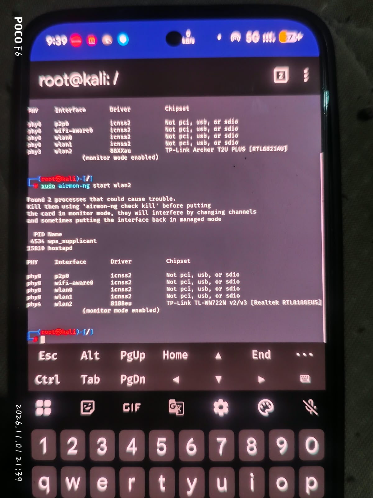
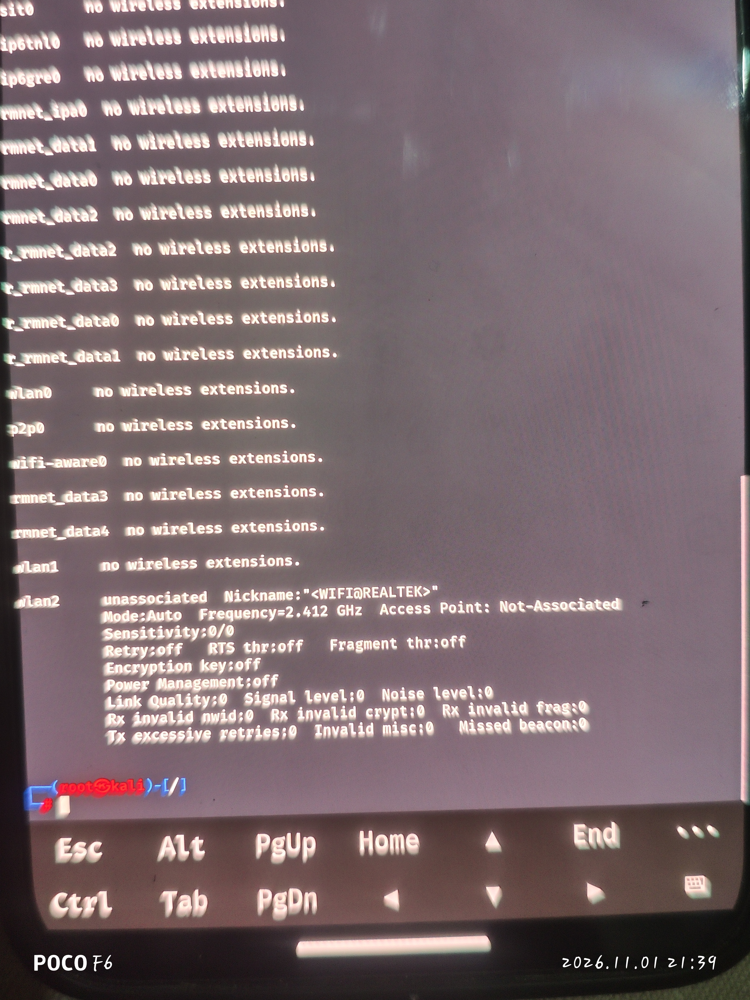
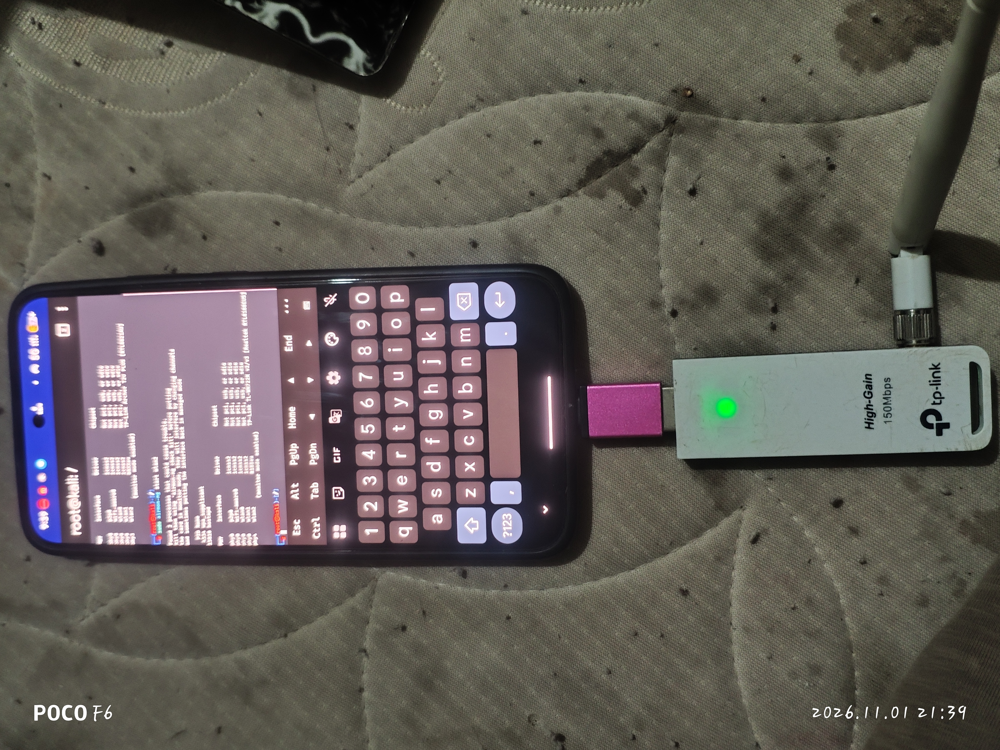
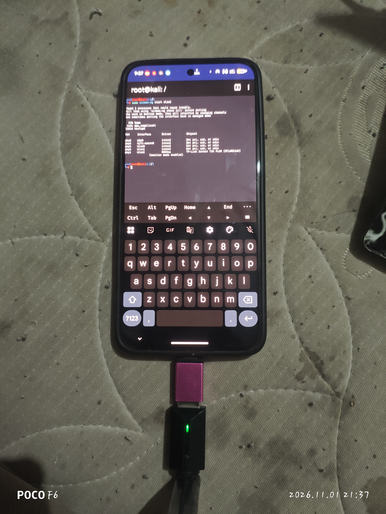

# User-provided device test photos

Photos supplied by the tester on2November2026; visible camera timestamps are1November2026. Images are published unchanged. No EXIF tags were present in the selected files. A separate network-address screenshot was excluded because it exposes IP/IPv6 and MAC addresses.

These photos illustrate physical connection, adapter detection and the monitor-mode status displayed by the tools. They do **not** independently prove packet injection, deauthentication, long-term stability, exact running kernel/module revision or ROM compatibility. Runtime version and probe-response results were checked separately. Camera watermarks are not used to identify the tested device.

## Both external adapters: monitor-mode status

The terminal displays Archer T2U Plus with88XXau and TL-WN722Nv2/v3 with8188eu as monitor mode enabled in separate adapter sessions. The airmon-ng warning about wpa_supplicant/hostapd is visible; this is not a clean-radio-environment or traffic-success claim. Do not run `airmon-ng check kill` blindly on a phone providing your internet hotspot.

## External interface details

`iwconfig` recognizes external wlan2, showing an unassociated interface in Mode:Auto and Power Management:off at the moment photographed. This image is **not** evidence that this particular snapshot is in monitor mode or associated with an AP. Internal interfaces showing no wireless extensions is not proof they lack nl80211 support.

## WN722N physical setup

User-provided physical setup photo: TP-Link adapter attached through OTG, LED illuminated, with terminal adapter/mode output. The matching driver/USBID was verified separately; appearance alone does not establish a hardware revision.

## Archer physical setup

User-provided Archer setup photo with OTG connection, illuminated adapter LED and terminal monitor-mode status. LED illumination alone does not prove frame transmission.

See the repository README for the tested Infinity-X4.1 Android17 setup and the scope/limits of the separate bounded probe-injection tests.
